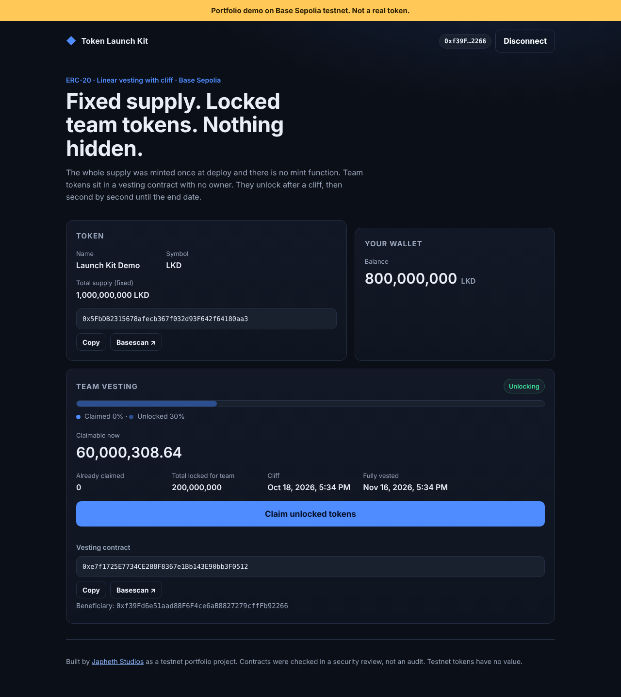
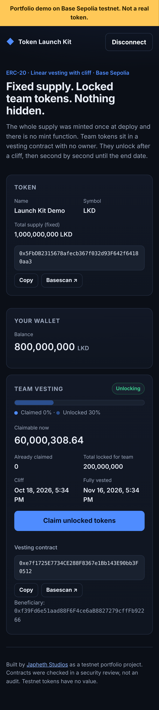

# Token Launch Kit

> **Portfolio demo on Base Sepolia testnet. Not a real token.** Testnet tokens have no value.

A complete token launch: a **fixed-supply ERC-20** (no mint after deploy), a **linear vesting contract with a cliff** for team tokens, a Foundry deploy script for Base Sepolia, and a **launch site** (Next.js + wagmi + viem) where anyone can check the supply and the team can claim unlocked tokens.

Built by [Japheth Studios](https://japhethstudios.com).

| | |
|---|---|
| **Live site** | https://onose-a-j.github.io/blockchain-don-talk/portfolio/token-launch-kit/ |
| **Network** | Base Sepolia (chain id 84532) |
| **LaunchToken** | _pending testnet deploy_ |
| **TokenVesting** | _pending testnet deploy_ |
| **Tests** | 37 Foundry tests (7 fuzz × 10,000 runs, 3 invariants × 16,384 calls) · 9 unit tests · 13 browser end-to-end tests |





## What it does

**`LaunchToken.sol`**: an OpenZeppelin ERC-20. The whole supply is minted once, in the constructor, to one recipient. There is no `mint` function, no owner and no admin role, so the supply can never grow.

**`TokenVesting.sol`**: holds team tokens for one beneficiary.

- Nothing is claimable before the **cliff**.
- From the cliff on, the vested amount is `total × (now − start) / duration`, rounded down.
- After `start + duration`, everything is claimable.
- Only the beneficiary can call `claim()`, and only for what has vested. There is no owner, no revoke and no sweep. Nobody can pull tokens out early, not even the deployer.

**Launch site** (`site/`):

- Token name, symbol and fixed supply, plus the contract address with a copy button and a Basescan link
- Connect-wallet button (any browser wallet: MetaMask, Coinbase Wallet, Rabby…)
- The connected wallet's token balance
- A vesting panel with a progress bar, claimable amount, cliff and end dates, and a **Claim** button
- Plain-language messages, for example *"Wrong network. Switch to Base Sepolia."* and *"You cancelled the request in your wallet. Nothing was sent."*, never raw RPC errors
- Works on phones, can be used with the keyboard (visible focus rings), and has labelled controls and live regions for screen readers
- Status ("Before cliff / Unlocking / Fully vested") follows **chain time**, the same clock the contract uses

## Project layout

```
contracts/   Foundry project: src/, test/, script/Deploy.s.sol
site/        Next.js static site (wagmi + viem), Vitest unit tests, Playwright e2e tests
scripts/     deploy-base-sepolia.sh: deploy, verify, and write addresses for the site
docs/        screenshots
```

## Run the tests

Requirements: Node.js 20+, [Foundry](https://getfoundry.sh).

```bash
# contracts
cd contracts
npm ci                 # OpenZeppelin + forge-std
forge test             # 37 tests; fuzz tests run 10,000 cases each

# site unit tests
cd ../site
npm ci
npm test               # 9 tests (error messages, number formatting)

# site end-to-end: starts anvil with chain id 84532, runs the real deploy script,
# builds the site, then drives it in Chromium (desktop + phone) with a test wallet
npx playwright install chromium
npm run e2e            # 13 tests
```

Test output:

```
Ran 4 test suites: 37 tests passed, 0 failed, 0 skipped (37 total tests)
 ✓ test/LaunchToken.t.sol        7 passed
 ✓ test/TokenVesting.t.sol      25 passed  (fuzz: 10,000 runs each)
 ✓ test/invariant/...            3 passed  (256 runs × 64 calls each)
 ✓ test/Deploy.t.sol             2 passed
Vitest:      9 passed
Playwright: 13 passed, 1 skipped (clipboard check is desktop-only)
```

### What the tests cover

| Area | Tests |
|---|---|
| Fixed supply | whole supply goes to the recipient; zero supply and zero recipient revert; `mint` selectors don't exist; fuzzed transfers never change total supply |
| Vesting math | **fuzzed across 10,000 random timestamps**: 0 before the cliff, the exact linear amount between, 100% after the end; monotonic; random allocations, cliffs and durations |
| Breaking it | claim before the cliff, claim before the start, claim twice in the same block, claim twice after the end, a **non-beneficiary** claiming (fuzzed callers), deployer trying `withdraw/revoke/sweep/transferOwnership`, a token donation trying to unlock early, a **reentrant token** trying to double-claim |
| Rounding | claiming every 1–60 days ends with exactly 100% claimed, with no dust left behind |
| Invariants | tokens conserved (beneficiary + contract = allocation); released ≤ vested; nothing released before the cliff; random strangers never claim |
| Deploy script | wires token + vesting + 20% team allocation; **refuses to run on mainnet** (only 84532 or local 31337) |
| Site (browser) | testnet banner; token facts without a wallet; copy button; wrong-network message + switch; claim blocked before the cliff; non-beneficiary told it can't claim; cancelled claim message; successful claim with tx link; all on desktop and phone |

## Deploy (Base Sepolia only)

1. Create a **new** wallet used only for testnets. Fund it from a Base Sepolia faucet.
2. `cp .env.example .env` and fill in `PRIVATE_KEY` (and `ETHERSCAN_API_KEY` to verify on Basescan).
3. Run:

```bash
./scripts/deploy-base-sepolia.sh
```

The script checks that the RPC is Base Sepolia, deploys both contracts, funds vesting with 20% of supply (10-minute cliff, 30-day vest by default, so the claim flow is easy to demo), verifies on Basescan when a key is set, and writes the addresses to `site/src/lib/deployment.json`.

The site deploys to GitHub Pages through `.github/workflows/pages.yml` (static export, `basePath` = repo name). Set **Settings → Pages → Source → GitHub Actions** once.

## Security notes

This is a **security review**, not an audit. What was checked:

- **Reentrancy**: `claim()` is `nonReentrant` and follows checks-effects-interactions (`released` is updated before the transfer). A test uses a malicious token that re-enters `claim()` from `transfer()`; it reverts with `ReentrancyGuardReentrantCall`.
- **Access control**: only `beneficiary` can claim (fuzzed over random callers). No owner, admin, pause, revoke or sweep exists on either contract. The token has no mint path after construction.
- **Integer rounding**: vesting rounds **down**, so it can never release more than vested. Repeated claims at any interval sum to exactly the allocation, with no dust stuck. Solidity 0.8 checked arithmetic; `total × elapsed` cannot overflow for any realistic supply (it would need over 10⁶⁰ tokens).
- **Unchecked external calls**: token transfers use OpenZeppelin `SafeERC20`.
- **Static analysis**: [Slither](https://github.com/crytic/slither) reports no issues beyond two expected notes: `amount == 0` (a deliberate guard) and the use of `block.timestamp`. Timestamp use is inherent to vesting; a block producer can shift it by a few seconds at most, which moves at most a few seconds' worth of vesting.
- **Deploy safety**: the deploy script refuses any chain except Base Sepolia and local anvil.

Known limits:

- Tokens sent directly to the vesting contract join the same schedule (they increase `totalAllocation`). This is intended: they can't be recovered by anyone but the beneficiary, and only on schedule.
- One beneficiary per vesting contract. Deploy one contract per team member, or extend to a multi-schedule contract.
- The beneficiary address is immutable. If that wallet is lost, its unclaimed tokens are locked forever.
- Not designed for fee-on-transfer or rebasing tokens (it is used with its own plain ERC-20).

## License

MIT. See [LICENSE](LICENSE).
